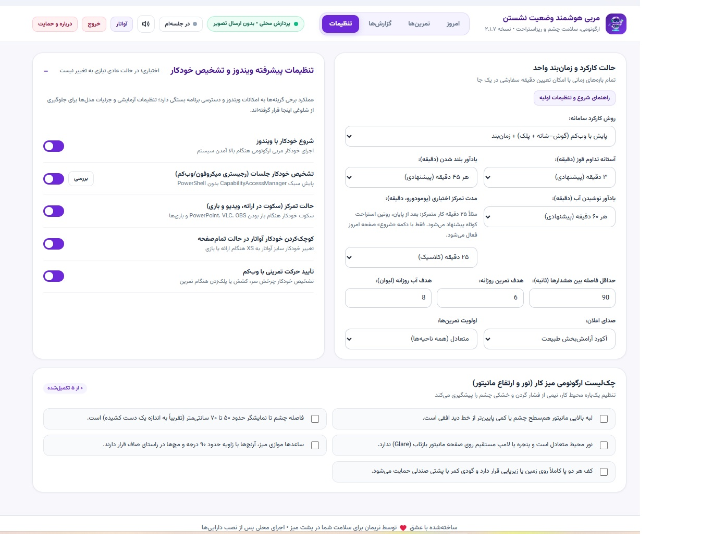
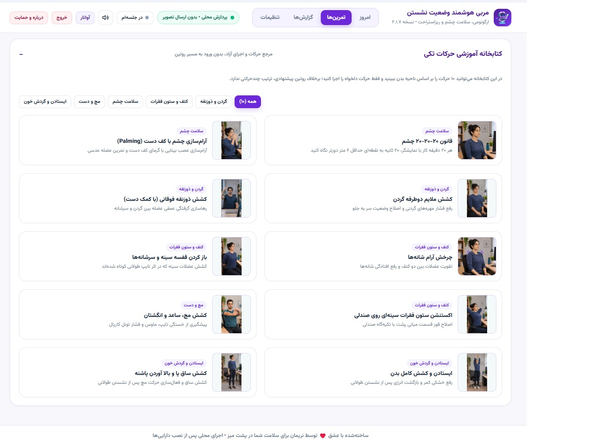

<div dir="rtl" align="right">

# 🪑 PostureCoach | مربی هوشمند وضعیت نشستن

**نرم‌افزار رایگان فارسی برای آگاهی از وضعیت نشستن، مراقبت از چشم و مدیریت استراحت هنگام کار با رایانه**

<p align="center">
  <a href="https://github.com/hgolmohammadi/posture-coach-releases/releases/latest"></a>
  
  
  
</p>

## ⬇️ دانلود نسخه ویندوز

### **[📦 دریافت نسخه ZIP (همراه راهنمای فارسی)](https://github.com/hgolmohammadi/posture-coach-releases/releases/download/v2.1.8/PostureCoach-2.1.8-Windows-Portable.zip)**

پس از دانلود، فایل ZIP را استخراج کنید و فایل اجرایی داخل آن را اجرا کنید.

**[دانلود مستقیم EXE بدون فایل ZIP](https://github.com/hgolmohammadi/posture-coach-releases/releases/download/v2.1.8/PostureCoach-2.1.8-Windows-Portable.exe)** · **[بررسی SHA-256 بسته ZIP](https://github.com/hgolmohammadi/posture-coach-releases/releases/download/v2.1.8/ZIP-SHA256.txt)**

> **مهم:** ZIP امضای دیجیتال ایجاد نمی‌کند و ممکن است Microsoft Edge یا SmartScreen هنگام دانلود، استخراج یا اجرای فایل همچنان هشدار دهد؛ هیچ تنظیم امنیتی ویندوز را برای اجرای برنامه غیرفعال نکنید.

**نسخه:** 2.1.8 · **سیستم‌عامل:** Windows x64 · **نوع:** فایل EXE پرتابل · **حجم:** حدود ۱۲۵ مگابایت

[توضیحات نسخه](https://github.com/hgolmohammadi/posture-coach-releases/releases/tag/v2.1.8) · [فایل بررسی SHA-256](https://github.com/hgolmohammadi/posture-coach-releases/releases/download/v2.1.8/SHA256SUMS.txt) · [گزارش مشکل](https://github.com/hgolmohammadi/posture-coach-releases/issues/new?template=bug_report.yml)

> **توجه امنیتی:** نسخه فعلی امضای دیجیتال معتبر ناشر ندارد. برنامه را فقط از صفحه رسمی دانلود کنید و Windows Defender یا SmartScreen را غیرفعال نکنید.

---

## چرا PostureCoach؟

کار طولانی پشت رایانه باعث می‌شود استراحت‌کردن و توجه به وضعیت بدن را فراموش کنیم. PostureCoach با یادآوری‌های قابل تنظیم، تمرین‌های تصویری و **بررسی تخمینی تغییر وضعیت سر و شانه نسبت به حالت کالیبره‌شده** به مدیریت عادت‌های کاری کمک می‌کند.

| قابلیت | کاربرد |
|:---|:---|
| 📷 **پایش سر و شانه** | تحلیل محلی تصویر وب‌کم، کالیبراسیون و هشدار تغییر وضعیت نسبت به مرجع |
| 🤖 **آواتار شناور** | یادآوری روی دسکتاپ، بدون مسدودکردن کلیک روی پنجره‌های زیرین |
| 👁️ **سلامت چشم** | قانون ۲۰-۲۰-۲۰، پایش پلک‌زدن و تغییر فاصله نسبی چهره تا دوربین |
| 🧘 **۱۰ تمرین کوتاه** | انیمیشن و راهنمای فارسی برای چشم، گردن، شانه، پشت، مچ و پا |
| ⏰ **کار و استراحت** | تایمر پومودورو، وقفه‌ها، سوابق فعالیت و روتین‌های کوتاه |
| 🔒 **حریم خصوصی** | پردازش تصویر روی دستگاه و فعال‌سازی اختیاری دوربین |

## 📸 تصاویر واقعی برنامه

تصاویر زیر از محیط فارسی PostureCoach گرفته شده‌اند. برای مشاهده اندازه اصلی، روی تصویر کلیک کنید.

### داشبورد اصلی و آواتار دسکتاپ

<p align="center">
  <a href="docs/images/home-overview.jpg"></a>
</p>

### آشنایی با بخش‌های برنامه

<table>
  <tr>
    <td align="center" width="50%">
      <a href="docs/images/settings-page.jpg"></a>
      <p><strong>تنظیمات و یادآورها</strong></p>
    </td>
    <td align="center" width="50%">
      <a href="docs/images/reports-page.jpg"></a>
      <p><strong>گزارش‌ها و روند فعالیت</strong></p>
    </td>
  </tr>
</table>

<p align="center">
  <a href="docs/images/exercises-page.jpg"></a>
</p>
<p align="center"><strong>کتابخانه ۱۰ تمرین آموزشی</strong></p>

---

## شروع سریع

۱. فایل EXE را از لینک رسمی بالا دریافت و ذخیره کنید.

۲. فایل را اجرا کنید و یادآورها را متناسب با نیاز تنظیم کنید.

۳. در صورت تمایل به پایش تصویری، اجازه دسترسی به وب‌کم را بدهید. صورت و **هر دو شانه** را داخل کادر قرار دهید و در حالت مناسب کالیبره کنید.

۴. از آواتار و تمرین‌های کوتاه در طول روز استفاده کنید. برای بستن کامل برنامه، دکمه **خروج** صفحه اصلی را بزنید.

**شرایط مناسب دوربین:** نور کافی، زاویه تقریباً هم‌سطح چشم، دید واضح از شانه‌ها و کالیبراسیون دوباره پس از جابه‌جایی.

## حریم خصوصی و محدودیت‌ها

- پردازش تصویر برای تحلیل چهره و سر و شانه روی خود رایانه انجام می‌شود.
- برای تحلیل معمول، تصویر زنده وب‌کم به سرور ابری ارسال نمی‌شود.
- دوربین اختیاری است و بخشی از قابلیت‌های برنامه بدون آن در دسترس‌اند.
- تنظیمات و سابقه فعالیت به‌صورت محلی مدیریت می‌شوند.
- **این برنامه انحنای واقعی ستون فقرات را اندازه‌گیری نمی‌کند و ابزار تشخیص یا درمان پزشکی نیست.**

[سیاست حریم خصوصی](PRIVACY.md) · [راهنمای پشتیبانی](SUPPORT.md) · [گزارش امنیتی](SECURITY.md)

## بررسی فایل دانلودی

در PowerShell در پوشه دانلود فایل اجرا کنید:

```powershell
Get-FileHash .\PostureCoach-2.1.8-Windows-Portable.exe -Algorithm SHA256
```

هش رسمی نسخه:

```text
95D75CC97E1213A909B527926E69937C5B3C40C0C53B591159491D2C7A0FAC23
```

تطابق هش، یکسان‌بودن فایل با نسخه منتشرشده را بررسی می‌کند؛ به‌تنهایی تضمین‌کننده ایمنی نیست.

## پرسش‌های متداول

**آیا نصب لازم است؟** خیر، نسخه فعلی Portable است.

**آیا اینترنت لازم است؟** برای دریافت فایل بله؛ قابلیت‌های اصلی برای اجرا بدون اتصال دائمی طراحی شده‌اند.

**اگر دوربین نتواند شانه‌ها را ببیند چه می‌شود؟** ارزیابی ممکن است «نامشخص» شود؛ نمای دوربین را اصلاح و دوباره کالیبره کنید.

**آیا پروژه متن‌باز است؟** این مخزن صرفاً محل انتشار فایل‌های اجرایی است؛ فایل‌های خودکار «Source code» شامل سورس کامل برنامه نیستند.

## مشارکت در بهبود

[🐞 ثبت گزارش خطا](https://github.com/hgolmohammadi/posture-coach-releases/issues/new?template=bug_report.yml) · [💡 پیشنهاد قابلیت](https://github.com/hgolmohammadi/posture-coach-releases/issues/new?template=feature_request.yml)

از انتشار عمومی تصویر چهره، وب‌کم، اطلاعات حساب یا گزارش‌های حاوی داده شخصی خودداری کنید.

---

**PostureCoach — رایگان، فارسی و همراه شما برای عادت‌های کاری سالم‌تر.**

</div>

**English:** PostureCoach is a free Persian-language Windows desktop application for posture awareness, eye breaks and guided exercise routines. Camera analysis runs locally and does not provide medical diagnosis.
