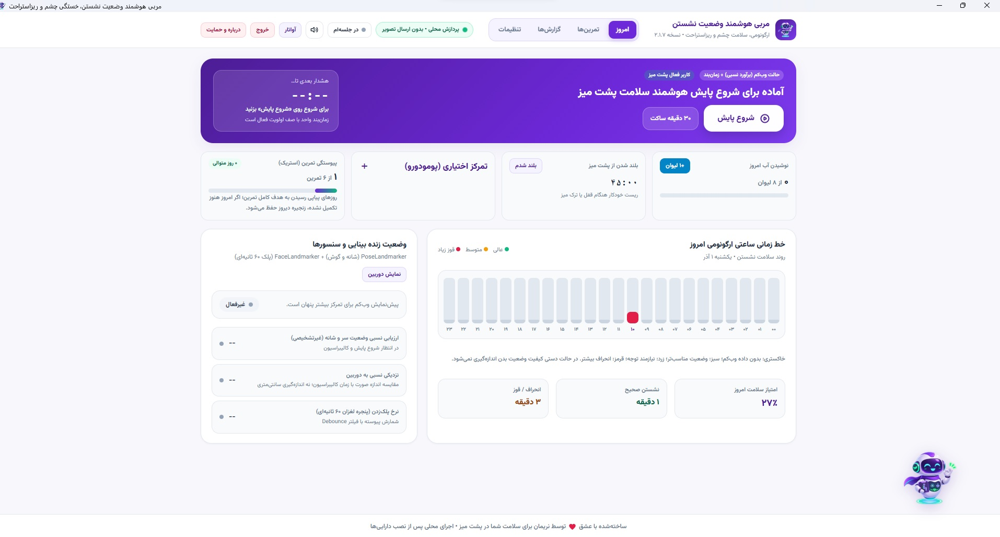
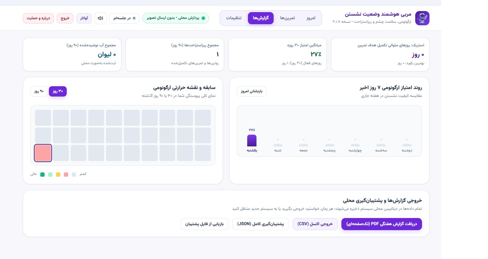

<h1 dir="rtl" align="right">🪑 PostureCoach | مربی هوشمند وضعیت نشستن</h1>

<strong>نرم‌افزار رایگان فارسی برای آگاهی از وضعیت نشستن، مراقبت از چشم و مدیریت استراحت هنگام کار با رایانه</strong>

  
  
  
  

<h2 dir="rtl" align="right">⬇️ دانلود نسخه ویندوز</h2>

<h3 dir="rtl" align="right"><a href="https://github.com/hgolmohammadi/posture-coach-releases/releases/download/v1.0.0/PostureCoach-1.0.0-Windows-Portable.zip">📦 دریافت نسخه ZIP (همراه راهنمای فارسی)</a></h3>

پس از دانلود، فایل ZIP را استخراج کنید و فایل اجرایی داخل آن را اجرا کنید.

<strong><a href="https://github.com/hgolmohammadi/posture-coach-releases/releases/download/v1.0.0/PostureCoach-1.0.0-Windows-Portable.exe">دانلود مستقیم EXE بدون فایل ZIP</a></strong> · <strong><a href="https://github.com/hgolmohammadi/posture-coach-releases/releases/download/v1.0.0/SHA256SUMS.txt">بررسی SHA-256 بسته ZIP</a></strong>

<strong>نسخه:</strong> 1.0.0 · <strong>سیستم‌عامل:</strong> Windows x64 · <strong>نوع:</strong> فایل EXE پرتابل · <strong>حجم:</strong> حدود ۱۲۵ مگابایت

<a href="https://github.com/hgolmohammadi/posture-coach-releases/releases/tag/v1.0.0">توضیحات نسخه</a> · <a href="https://github.com/hgolmohammadi/posture-coach-releases/releases/download/v1.0.0/SHA256SUMS.txt">فایل بررسی SHA-256</a> · <a href="https://github.com/hgolmohammadi/posture-coach-releases/issues/new?template=bug_report.yml">گزارش مشکل</a>

<h2 dir="rtl" align="right">چرا PostureCoach؟</h2>

کار طولانی پشت رایانه باعث می‌شود استراحت‌کردن و توجه به وضعیت بدن را فراموش کنیم. PostureCoach با یادآوری‌های قابل تنظیم، تمرین‌های تصویری و <strong>بررسی تخمینی تغییر وضعیت سر و شانه نسبت به حالت کالیبره‌شده</strong> به مدیریت عادت‌های کاری کمک می‌کند.

<table dir="rtl" width="100%">
<thead><tr><th align="right" dir="rtl">قابلیت</th><th align="right" dir="rtl">کاربرد</th></tr></thead>
<tbody>
<tr><td align="right" dir="rtl">📷 <strong>پایش سر و شانه</strong></td><td align="right" dir="rtl">تحلیل محلی تصویر وب‌کم، کالیبراسیون و هشدار تغییر وضعیت نسبت به مرجع</td></tr>
<tr><td align="right" dir="rtl">🤖 <strong>آواتار شناور</strong></td><td align="right" dir="rtl">یادآوری روی دسکتاپ، بدون مسدودکردن کلیک روی پنجره‌های زیرین</td></tr>
<tr><td align="right" dir="rtl">👁️ <strong>سلامت چشم</strong></td><td align="right" dir="rtl">قانون ۲۰-۲۰-۲۰، پایش پلک‌زدن و تغییر فاصله نسبی چهره تا دوربین</td></tr>
<tr><td align="right" dir="rtl">🧘 <strong>۱۰ تمرین کوتاه</strong></td><td align="right" dir="rtl">انیمیشن و راهنمای فارسی برای چشم، گردن، شانه، پشت، مچ و پا</td></tr>
<tr><td align="right" dir="rtl">⏰ <strong>کار و استراحت</strong></td><td align="right" dir="rtl">تایمر پومودورو، وقفه‌ها، سوابق فعالیت و روتین‌های کوتاه</td></tr>
<tr><td align="right" dir="rtl">🔒 <strong>حریم خصوصی</strong></td><td align="right" dir="rtl">پردازش تصویر روی دستگاه و فعال‌سازی اختیاری دوربین</td></tr>
</tbody>
</table>

<h2 dir="rtl" align="right">📸 تصاویر واقعی برنامه</h2>

تصاویر زیر از محیط فارسی PostureCoach گرفته شده‌اند. برای مشاهده اندازه اصلی، روی تصویر کلیک کنید.

<h3 dir="rtl" align="right">داشبورد اصلی و آواتار دسکتاپ</h3>

<h3 dir="rtl" align="right">آشنایی با بخش‌های برنامه</h3>

<table dir="rtl">
<tr>
<td align="center" width="50%">
<strong>تنظیمات و یادآورها</strong>
</td>
<td align="center" width="50%">
<strong>گزارش‌ها و روند فعالیت</strong>
</td>
</tr>
</table>

<strong>کتابخانه ۱۰ تمرین آموزشی</strong>

<h2 dir="rtl" align="right">شروع سریع</h2>

<ol dir="rtl" align="right">
<li dir="rtl" align="right">فایل EXE را از لینک رسمی بالا دریافت و ذخیره کنید.</li>
<li dir="rtl" align="right">فایل را اجرا کنید و یادآورها را متناسب با نیاز تنظیم کنید.</li>
<li dir="rtl" align="right">در صورت تمایل به پایش تصویری، اجازه دسترسی به وب‌کم را بدهید. صورت و <strong>هر دو شانه</strong> را داخل کادر قرار دهید و در حالت مناسب کالیبره کنید.</li>
<li dir="rtl" align="right">از آواتار و تمرین‌های کوتاه در طول روز استفاده کنید. برای بستن کامل برنامه، دکمه <strong>خروج</strong> صفحه اصلی را بزنید.</li>
</ol>

<strong>شرایط مناسب دوربین:</strong> نور کافی، زاویه تقریباً هم‌سطح چشم، دید واضح از شانه‌ها و کالیبراسیون دوباره پس از جابه‌جایی.

<h2 dir="rtl" align="right">حریم خصوصی و محدودیت‌ها</h2>

<ul dir="rtl" align="right">
<li dir="rtl" align="right">پردازش تصویر برای تحلیل چهره و سر و شانه روی خود رایانه انجام می‌شود.</li>
<li dir="rtl" align="right">برای تحلیل معمول، تصویر زنده وب‌کم به سرور ابری ارسال نمی‌شود.</li>
<li dir="rtl" align="right">دوربین اختیاری است و بخشی از قابلیت‌های برنامه بدون آن در دسترس‌اند.</li>
<li dir="rtl" align="right">تنظیمات و سابقه فعالیت به‌صورت محلی مدیریت می‌شوند.</li>
<li dir="rtl" align="right"><strong>این برنامه انحنای واقعی ستون فقرات را اندازه‌گیری نمی‌کند و ابزار تشخیص یا درمان پزشکی نیست.</strong></li>
</ul>

<a href="PRIVACY.md">سیاست حریم خصوصی</a> · <a href="SUPPORT.md">راهنمای پشتیبانی</a> · <a href="SECURITY.md">گزارش امنیتی</a>

<h2 dir="rtl" align="right">بررسی فایل دانلودی</h2>

در PowerShell در پوشه دانلود فایل اجرا کنید:

<pre dir="ltr" align="left"><code>Get-FileHash .\PostureCoach-1.0.0-Windows-Portable.exe -Algorithm SHA256</code></pre>

هش رسمی نسخه:

<pre dir="ltr" align="left"><code>C289F5736815DAB5E8C815508FFF09F16D5044B73574A45C68730F2351586406</code></pre>

تطابق هش، یکسان‌بودن فایل با نسخه منتشرشده را بررسی می‌کند؛ به‌تنهایی تضمین‌کننده ایمنی نیست.

<h2 dir="rtl" align="right">پرسش‌های متداول</h2>

<strong>آیا نصب لازم است؟</strong> خیر، نسخه فعلی Portable است.

<strong>آیا اینترنت لازم است؟</strong> برای دریافت فایل بله؛ قابلیت‌های اصلی برای اجرا بدون اتصال دائمی طراحی شده‌اند.

<strong>اگر دوربین نتواند شانه‌ها را ببیند چه می‌شود؟</strong> ارزیابی ممکن است «نامشخص» شود؛ نمای دوربین را اصلاح و دوباره کالیبره کنید.

<strong>آیا پروژه متن‌باز است؟</strong> این مخزن صرفاً محل انتشار فایل‌های اجرایی است؛ فایل‌های خودکار «Source code» شامل سورس کامل برنامه نیستند.

<h2 dir="rtl" align="right">مشارکت در بهبود</h2>

<a href="https://github.com/hgolmohammadi/posture-coach-releases/issues/new?template=bug_report.yml">🐞 ثبت گزارش خطا</a> · <a href="https://github.com/hgolmohammadi/posture-coach-releases/issues/new?template=feature_request.yml">💡 پیشنهاد قابلیت</a>

از انتشار عمومی تصویر چهره، وب‌کم، اطلاعات حساب یا گزارش‌های حاوی داده شخصی خودداری کنید.

<strong>PostureCoach — رایگان، فارسی و همراه شما برای عادت‌های کاری سالم‌تر.</strong>

<strong>English:</strong> PostureCoach is a free Persian-language Windows desktop application for posture awareness, eye breaks and guided exercise routines. Camera analysis runs locally and does not provide medical diagnosis.

