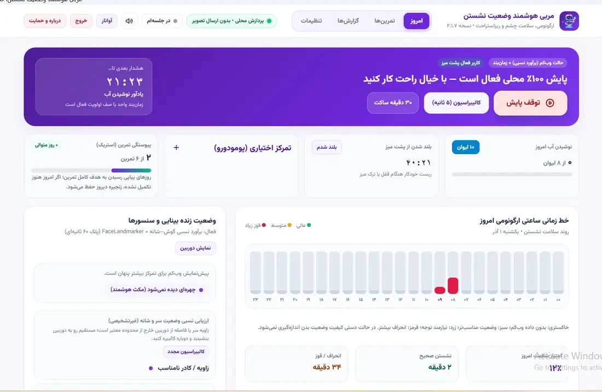
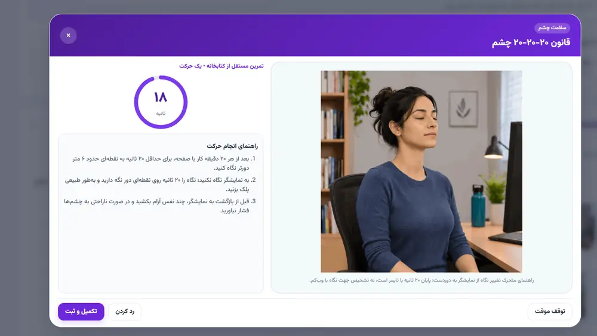

<div dir="rtl" align="right">

# 🪑 PostureCoach | مربی هوشمند وضعیت نشستن

**نرم‌افزار رایگان فارسی برای آگاهی از وضعیت نشستن، استراحت منظم، سلامت چشم و تمرین‌های کوتاه هنگام کار با رایانه**

<p align="center">
  <a href="https://github.com/hgolmohammadi/posture-coach-releases/releases/latest"></a>
  
  
  
</p>

## دانلود

### [⬇️ دانلود مستقیم PostureCoach 2.1.8 برای ویندوز](https://github.com/hgolmohammadi/posture-coach-releases/releases/download/v2.1.8/PostureCoach-2.1.8-Windows-Portable.exe)

- **نسخه فعلی:** 2.1.8
- **سیستم‌عامل هدف:** Windows 64-bit
- **نوع انتشار:** Portable EXE
- **حجم فایل:** حدود 125 مگابایت
- **فایل بررسی یکپارچگی:** [SHA256SUMS.txt](https://github.com/hgolmohammadi/posture-coach-releases/releases/download/v2.1.8/SHA256SUMS.txt)
- **یادداشت نسخه:** [مشاهده Release Notes](https://github.com/hgolmohammadi/posture-coach-releases/releases/latest)

> **توجه:** نسخه فعلی امضای دیجیتال تجاری ندارد. برنامه را فقط از همین صفحه رسمی GitHub دریافت کنید.

---

## PostureCoach چه کاری انجام می‌دهد؟

PostureCoach برای افرادی طراحی شده که ساعت‌های طولانی پشت میز و رایانه کار می‌کنند و می‌خواهند:

- استراحت‌های منظم را فراموش نکنند
- نسبت به تغییر وضعیت سر و شانه آگاه‌تر شوند
- تمرین‌های کوتاه و ساده را در طول روز انجام دهند
- سلامت چشم و عادت‌های کاری خود را بهتر مدیریت کنند

این برنامه با استفاده از وب‌کم، **تغییرات نسبی وضعیت سر و شانه را نسبت به حالت کالیبره‌شده** بررسی می‌کند و هنگام نیاز یادآوری یا راهنمای تمرین نمایش می‌دهد.

> **نکته مهم:** PostureCoach ابزار کمکی برای آگاهی از عادت‌های کاری است و **ابزار تشخیص پزشکی** نیست.

---

## قابلیت‌های اصلی

| قابلیت | توضیح |
|---|---|
| 📷 **پایش نسبی سر و شانه** | تحلیل محلی تصویر وب‌کم نسبت به وضعیت مرجع، همراه با کالیبراسیون |
| 🤖 **آواتار شناور دسکتاپ** | یادآوری تصویری بدون جلوگیری از کلیک روی پنجره‌های زیرین |
| 👁️ **سلامت چشم** | قانون 20-20-20، بررسی پلک‌زدن و هشدارهای مرتبط |
| 🧘 **کتابخانه تمرین‌ها** | 10 تمرین آموزشی برای چشم، گردن، شانه، پشت، مچ و پا |
| ⏰ **مدیریت وقفه و تمرکز** | یادآورها، پومودورو، سوابق روزانه و روتین‌های کوتاه |
| 🔒 **حریم خصوصی** | پردازش تصویر به‌صورت محلی و بدون ارسال تصویر به سرویس ابری |

---

## تصاویر برنامه

### داشبورد اصلی



### نمونه پنجره تمرین — قانون 20-20-20 چشم



---

## شروع سریع

1. فایل EXE را از لینک بالا دانلود کنید.
2. فایل را در محل دلخواه ذخیره و اجرا کنید.
3. تنظیمات اولیه را انجام دهید.
4. اگر می‌خواهید از قابلیت پایش تصویری استفاده کنید:
   - به برنامه اجازه دسترسی به دوربین بدهید.
   - چهره و هر دو شانه را در کادر قرار دهید.
   - در حالت نشستن مناسب، **کالیبراسیون** را انجام دهید.
5. برای استفاده روزمره، از یادآورها، تمرین‌ها و آواتار شناور کمک بگیرید.
6. برای بستن کامل برنامه از دکمه **خروج** در صفحه اصلی استفاده کنید.

---

## برای بهترین عملکرد

- دوربین را تقریباً هم‌سطح چشم قرار دهید.
- نور مناسب و نمای واضح از صورت و شانه‌ها داشته باشید.
- اگر جای نشستن یا زاویه دوربین تغییر کرد، دوباره کالیبره کنید.
- در صورتی که صورت یا شانه‌ها کامل دیده نشوند، نتیجه ممکن است **نامشخص** باشد.

---

## حریم خصوصی و امنیت

- تحلیل وب‌کم برای قابلیت‌های اصلی برنامه **روی خود دستگاه** انجام می‌شود.
- تصویر زنده دوربین برای تحلیل معمول به سرویس ابری ارسال نمی‌شود.
- دوربین اختیاری است؛ برنامه بدون آن هم بخشی از قابلیت‌ها را ارائه می‌دهد.
- تنظیمات و اطلاعات فعالیت به‌صورت محلی نگهداری می‌شوند.

راهنمای کامل‌تر:
- [حریم خصوصی](PRIVACY.md)
- [پشتیبانی](SUPPORT.md)
- [گزارش مسائل امنیتی](SECURITY.md)

---

## بررسی یکپارچگی فایل دانلودی

پس از دانلود، می‌توانید هش فایل را در PowerShell بررسی کنید:

```powershell
Get-FileHash .\PostureCoach-2.1.8-Windows-Portable.exe -Algorithm SHA256
```

هش رسمی نسخه 2.1.8:

```text
95D75CC97E1213A909B527926E69937C5B3C40C0C53B591159491D2C7A0FAC23
```

> تطابق هش فقط نشان می‌دهد فایل دانلودشده با فایل منتشرشده یکسان است و به‌تنهایی تضمین‌کننده امنیت یا سلامت نرم‌افزار نیست.

---

## پرسش‌های رایج

### آیا برنامه نیاز به نصب دارد؟
خیر. نسخه فعلی Portable است و بدون نصب‌کننده جداگانه اجرا می‌شود.

### آیا برای استفاده از برنامه باید اینترنت داشته باشم؟
برای دانلود فایل بله، اما قابلیت‌های اصلی برای کار آفلاین طراحی شده‌اند.

### آیا این برنامه تشخیص پزشکی می‌دهد؟
خیر. PostureCoach تنها یک ابزار کمکی برای آگاهی از عادت‌های کاری و وضعیت نسبی بدن است.

### آیا سورس کامل برنامه در این مخزن قرار دارد؟
خیر. این مخزن مخصوص **انتشار نسخه اجرایی** است. فایل‌های خودکار GitHub با نام Source code فقط محتوای همین مخزن انتشار را شامل می‌شوند.

---

## بازخورد و گزارش مشکل

- [گزارش خطا](https://github.com/hgolmohammadi/posture-coach-releases/issues/new?template=bug_report.yml)
- [پیشنهاد قابلیت](https://github.com/hgolmohammadi/posture-coach-releases/issues/new?template=feature_request.yml)
- [لیست Issueها](https://github.com/hgolmohammadi/posture-coach-releases/issues)

لطفاً هنگام ثبت Issue عمومی، تصویر وب‌کم، چهره یا اطلاعات خصوصی خود را منتشر نکنید.

---

**PostureCoach** — رایگان، فارسی و همراه شما برای عادت‌های کاری سالم‌تر.

</div>